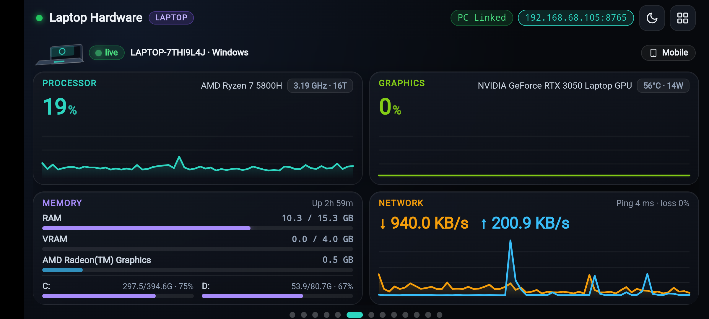
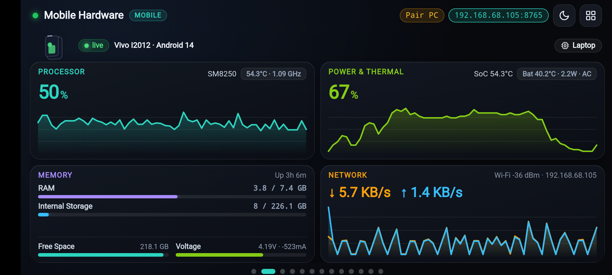
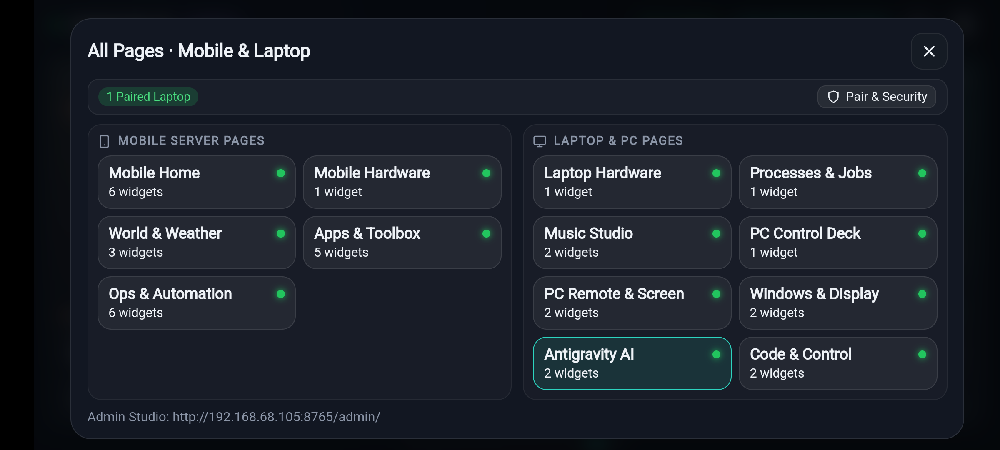
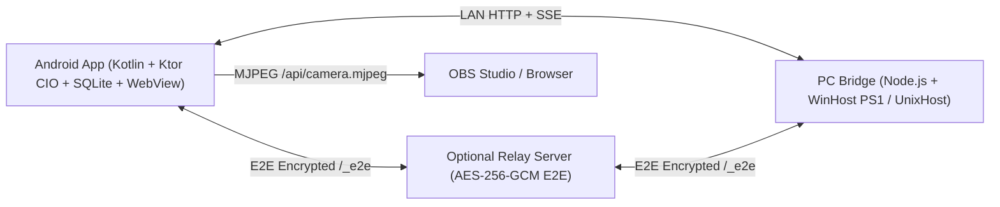

<div align="center">


# F.R.I.D.A.Y.

### Your Android phone, reborn as a wireless PC command deck, 3D audio studio, voice remote, and OBS camera.

<p>
  <a href="https://sandyddeveloper.github.io/F.R.I.D.A.Y/"></a>
  <a href="https://github.com/sandyddeveloper/F.R.I.D.A.Y/releases/latest"></a>
  <a href="https://github.com/sandyddeveloper/F.R.I.D.A.Y/stargazers"></a>
  <a href="LICENSE"></a>
</p>

<p>
  <code>Android 8.0+</code> · <code>Windows · macOS · Linux</code> · <code>Node.js 18+</code> · <code>AES-256-GCM E2E Relay</code>
</p>

[Live Website](https://sandyddeveloper.github.io/F.R.I.D.A.Y/) · [Latest APK](https://github.com/sandyddeveloper/F.R.I.D.A.Y/releases/latest) · [Quick Start](#quick-start) · [Voice Commands](#voice-commands) · [OBS Camera](#obs-camera2-feed) · [CLI Reference](#cli-reference)

<br />


</div>

---

## Why F.R.I.D.A.Y.?

Most "phone-to-PC" apps stop at basic notifications. **F.R.I.D.A.Y.** turns an always-on Android device on your desk into a dedicated hardware control surface — running locally on your phone with zero cloud lock-in.

| Capability | What You Get |
|---|---|
| **3D Music & Audio Stage** | Live Windows SMTC album art, 1s timeline scrubbing, per-app mixer, one-tap output switching, and drag-to-orbit 3D hardware models synced to your active speaker or earbuds. |
| **PC Control Deck & Trackpad** | Smooth wireless trackpad, scroll rail, `Alt+Tab` / `Win+D` / `Snip` / `Task Mgr` hotkeys, app launcher, and **Live Screen Peek** with tap-to-click. |
| **Tap-to-Speak Voice Control** | Built-in Android `SpeechRecognizer` (*"Hey F.R.I.D.A.Y."*) to adjust volume, control media, switch desk profiles, launch apps, or lock your PC. |
| **OBS Camera2 MJPEG Feed** | Native `android.hardware.camera2` stream (`/api/camera.mjpeg`) you can drop straight into **OBS Studio** or **VLC** as a wireless webcam. |
| **Share Sheet & Instant PC Drop** | Share any photo, PDF, video, or text from any Android app directly into `~/Downloads/F.R.I.D.A.Y./` (or your PC clipboard) in one tap. |
| **Proximity Walk-Away Lock** | Detects LAN + Bluetooth absence and automatically turns off your monitor and locks your PC — then restores your arrival scene when you return. |
| **Process Monitor & Job Alerts** | Live CPU/RAM process list with **`Alert on Exit`** and **`Alert if Idle`** pings so you never babysit a long build or training run. |
| **Zero-Trust Security** | Mutual **6-digit pairing** on-device, cryptographic `X-PhoneBox-Token` auth, and **AES-256-GCM** encrypted envelopes when routing through the self-hostable relay. |

---

## Screenshots

<table>
  <tr>
    <td width="50%" align="center">
      
      <b>Laptop Telemetry & Control Deck</b>
    </td>
    <td width="50%" align="center">
      
      <b>Mobile Command Home</b>
    </td>
  </tr>
  <tr>
    <td width="50%" align="center">
      
      <b>3D Mobile Hardware Core</b>
    </td>
    <td width="50%" align="center">
      
      <b>6-Digit Mutual Pairing Gate</b>
    </td>
  </tr>
</table>

<details>
<summary>View All Pages Overview</summary>
<br />
<p align="center">
  
</p>
</details>

---

## Quick Start

### 1. Install on Android
Grab the latest APK from [**Releases**](https://github.com/sandyddeveloper/F.R.I.D.A.Y/releases/latest), or build locally:

```bash
./gradlew assembleDebug
adb install -r app/build/outputs/apk/debug/app-debug.apk
```

Open **F.R.I.D.A.Y.** on your phone (`Android 8.0+`) and grant permissions as needed:
- **Notification Listener** — Phone media sync, OTP copy popups, and Call-Aware Auto-Mute
- **Microphone** — Tap-to-speak voice commands
- **Camera** — Live Camera2 MJPEG feed

### 2. Connect Your Computer
Requires **Node.js 18+** on Windows, macOS, or Linux:

```bash
git clone https://github.com/sandyddeveloper/F.R.I.D.A.Y.git
cd F.R.I.D.A.Y
npm link

friday connect
```

1. `friday connect` discovers your phone on Wi-Fi (or accepts a Tailscale / Tunnel / Relay URL).
2. Tap **Allow** on your phone to reveal the **6-digit pairing code**.
3. Type the 6-digit code in your terminal to complete pairing.

### 3. Auto-Start on Boot (Recommended)

```bash
friday install-service
```

Registers a native background service (**Windows Task Scheduler**, **macOS LaunchAgent**, or **Linux systemd user service**) so your bridge reconnects automatically every time you boot.

---

## Voice Commands

Tap the **Mic** icon in the top bar (or say *"Hey F.R.I.D.A.Y."* before your command):

| Voice Command | Action |
|---|---|
| `Volume 60` | Sets PC master volume to `60%` |
| `Play` / `Pause` / `Next` / `Previous` | Controls active PC media |
| `Mute` / `Unmute` | Toggles system mute |
| `Coding mode` / `Night profile` / `Music` / `Meeting` | Switches desk scene profile |
| `Open Spotify` / `Open Notepad` | Launches the app on your PC |
| `Type <text>` | Types dictated text into the focused PC window |
| `Lock PC` / `Screen off` | Locks workstation or puts display to sleep |

---

## OBS Camera2 Feed

Turn your phone into a low-latency wireless webcam using Android's native `Camera2` pipeline:

1. Open the **Live Screen Peek + Camera** widget on your phone and tap **Cam**.
2. Copy the **OBS URL** displayed under the preview (`http://<phone-ip>:8765/api/camera.mjpeg`).
3. In **OBS Studio**, add **Media Source** (uncheck *Local File*, paste URL as Input) or **Browser Source** — instant wireless camera feed.

---

## Anywhere Access (E2E Encrypted)

Even outside your home network, F.R.I.D.A.Y. keeps your traffic private:

- **Tailscale / WireGuard / Cloudflare Tunnel:** Add your phone's tunnel URL in **Admin Studio -> Security -> Remote URL**. The CLI automatically prefers fast LAN Wi-Fi at home and fails over seamlessly when away.
- **Self-Hostable Relay (`relay/server.mjs`):**
  ```bash
  PORT=8787 node relay/server.mjs
  ```
  Enable **Connect out to Self-Host Relay** in Admin Studio, then connect from anywhere:
  ```bash
  friday connect https://your-relay.example.com/r/<room-id>
  ```
  Relay requests are wrapped in **`AES-256-GCM`** encrypted envelopes (`POST /_e2e`) derived from your paired device token, so the relay server only sees ciphertext.

---

## Architecture



| Directory | Purpose |
|---|---|
| `app/` | Android Kotlin foreground service, Ktor CIO HTTP/SSE server, SQLite (WAL), `Camera2`, `SpeechRecognizer`, and modular WebView dashboard |
| `bin/` | Cross-platform `friday` CLI (`phonebox.mjs`) & OS service installer |
| `bridge/` | Telemetry daemon (`phonebox-telemetry.mjs`), Windows WinRT/CoreAudio worker (`phonebox-winhost.ps1`), macOS/Linux worker (`phonebox-unixhost.mjs`) |
| `relay/` | Zero-dependency Node.js HTTP relay (`server.mjs`) |
| `docs/` | GitHub Pages showcase & latest APK landing page |

---

## CLI Reference

```bash
friday connect [url]        # Discover on LAN or connect via Relay/Tunnel with 6-digit pairing
friday start                # Start background bridge daemon
friday stop                 # Stop background bridge daemon
friday restart              # Restart background bridge daemon
friday status               # Show connection mode (LAN / Relay) and paired token status
friday install-service      # Register auto-start on boot (Windows / macOS / Linux)
friday uninstall-service    # Remove auto-start service
friday unpair               # Revoke phone token and clear local credentials
```

---

<div align="center">
  Built by <a href="https://github.com/sandyddeveloper">sandyddeveloper</a> · <a href="LICENSE">MIT License</a><br />
  <sub>If F.R.I.D.A.Y. upgraded your desk setup, drop a ⭐ on the repo.</sub>
</div>
