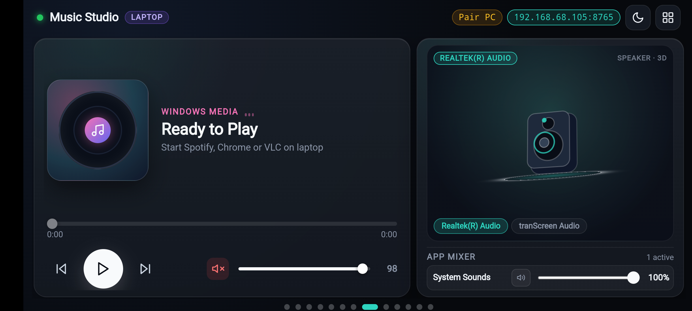
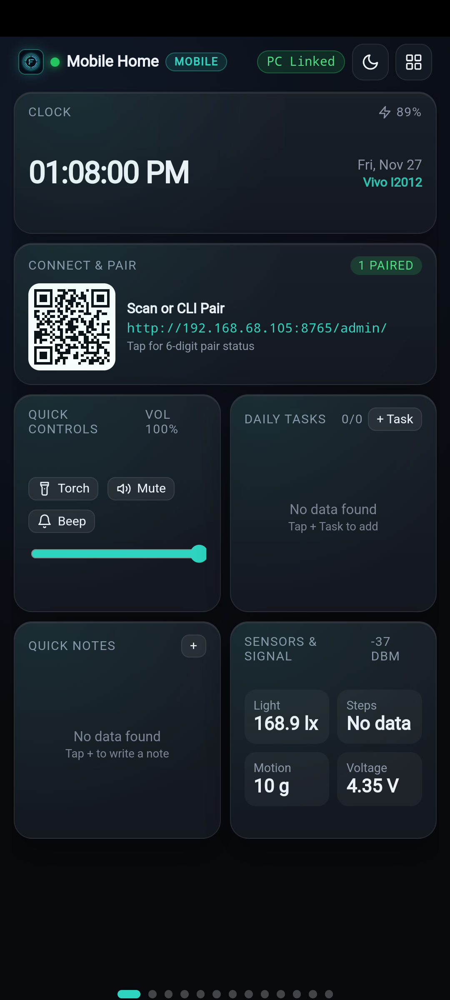
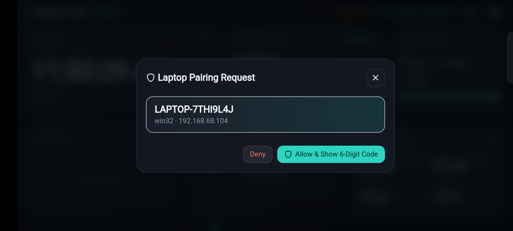

<div align="center">
  
  <h1>F.R.I.D.A.Y.</h1>
  <p><strong>Turn any Android phone into an always-on secondary smart monitor, PC control deck, 3D audio studio, wireless trackpad, voice assistant, and OBS camera — over Wi-Fi or anywhere on Earth.</strong></p>

  <p>
    <a href="https://sandyddeveloper.github.io/F.R.I.D.A.Y/"></a>
    <a href="https://github.com/sandyddeveloper/F.R.I.D.A.Y/releases/latest"></a>
    <a href="https://github.com/sandyddeveloper/F.R.I.D.A.Y/stargazers"></a>
    <a href="LICENSE"></a>
  </p>

  <p>
    
    
    
    
  </p>

  <p>
    <a href="https://sandyddeveloper.github.io/F.R.I.D.A.Y/">Explore Website</a> •
    <a href="https://github.com/sandyddeveloper/F.R.I.D.A.Y/releases/latest">Download APK</a> •
    <a href="#-quick-start">Quick Start</a> •
    <a href="#-voice-commands">Voice Commands</a> •
    <a href="#-camera2-obs-feed">OBS Camera</a> •
    <a href="#-connect-anywhere-e2e-encrypted">Anywhere Relay</a>
  </p>
</div>

---

## ✨ Visual Tour

<table>
  <tr>
    <td align="center" width="50%">
      <br />
      <strong>Music Studio & 3D Audio Stage</strong><br />
      <sub>Live SMTC album art, 1s timeline scrubbing, per-app mixer & drag-to-orbit 3D gear</sub>
    </td>
    <td align="center" width="50%">
      <br />
      <strong>Laptop Telemetry & Control Deck</strong><br />
      <sub>CPU/RAM/GPU gauges, process alerts, app launcher & Walk-Away Auto-Lock</sub>
    </td>
  </tr>
  <tr>
    <td align="center" width="50%">
      <br />
      <strong>Mobile Command Home</strong><br />
      <sub>Voice mic button, shared clipboard, quick files & instant PC drop</sub>
    </td>
    <td align="center" width="50%">
      <br />
      <strong>3D Mobile Hardware Core</strong><br />
      <sub>Real-time battery thermals, storage, network & interactive 3D device view</sub>
    </td>
  </tr>
  <tr>
    <td align="center" width="50%">
      <br />
      <strong>Clean Mobile vs. Laptop Pages</strong><br />
      <sub>Zero clutter — dedicated views for phone sensors, PC deck, screen peek & more</sub>
    </td>
    <td align="center" width="50%">
      <br />
      <strong>Zero-Trust 6-Digit Mutual Pairing</strong><br />
      <sub>Cryptographic token auth + AES-256-GCM encrypted relay envelopes</sub>
    </td>
  </tr>
</table>

---

## 🚀 What Makes F.R.I.D.A.Y. Next-Level

### 🎵 Unified Music Studio & 3D Hardware Stage
- **Real Windows SMTC / Media Controls** — Live album art, 1-second interpolated timeline & seek scrubbing, Play/Pause/Prev/Next, and master volume.
- **Interactive 3D Models** — Drag-to-orbit CSS `preserve-3d` models (TWS Earbuds + Case, Over-Ear Headphones, Acoustic Speaker, Soundbar, 3D Phone & Laptop cores) synced to your active audio output.
- **Instant Output Switcher & Per-App Mixer** — Switch between speakers, headphones, and Bluetooth in one tap.

### 🎙️ Tap-to-Speak Voice Commands (*"Hey F.R.I.D.A.Y."*)
- Built-in Android `SpeechRecognizer` triggered right from the topbar **Mic** button (`#btnVoice`).
- Natural command dispatcher with instant haptic feedback and desktop execution:

| Say This | What Happens |
|---|---|
| `"Hey F.R.I.D.A.Y., volume 60"` | Sets PC master volume to **60%** |
| `"Play"` / `"Pause"` / `"Next"` / `"Previous"` / `"Mute"` | Controls active PC media playback |
| `"Lock PC"` / `"Screen off"` | Immediately locks workstation or turns display off |
| `"Coding mode"` / `"Night profile"` / `"Music"` / `"Meeting"` | Switches your PC scene profile |
| `"Open Spotify"` / `"Open Notepad"` | Launches the app on your PC |
| `"Type hello world"` | Types text directly into the focused PC window |

### 📤 Android Share Sheet & Instant PC Drop
- Share any **photo, PDF, video, or text** from any Android app directly to **F.R.I.D.A.Y.** in the Android Share Sheet.
- Files are automatically queued and downloaded straight to `~/Downloads/F.R.I.D.A.Y./` on your PC with a desktop toast notification.
- Shared links or snippets sync straight to your PC clipboard.
- Need to push an older file? Tap **`[PC]`** in the **Files** widget anytime.

### 📷 Camera2 Live Companion & OBS MJPEG Feed
- Stream your phone's back or front camera directly from the **Live Screen Peek + Camera** widget using native Android `Camera2` (zero external bloat).
- Exposes a ready-to-use **MJPEG stream** (`GET /api/camera.mjpeg`) and snapshot endpoint (`GET /api/camera.jpg`).
- Paste the one-click **OBS URL** (`http://<phone-ip>:8765/api/camera.mjpeg`) into **OBS Studio -> Browser Source / Media Source** or **VLC** to use your phone as a crisp wireless webcam.

### 🔒 Proximity Auto-Lock & Arrival Scene Switcher
- Monitors LAN connectivity + Bluetooth device presence (`Get-PnpDevice` on Windows, `bluetoothctl` on Linux).
- **Walk-Away Lock**: Automatically turns off your display and locks your PC when you step away, with a 90-second cooldown and a quick toggle pill in the Display widget.
- **Arrival Scene**: Automatically applies your preferred scene profile (e.g. `coding` or `music`) the moment you walk back in.

### 🖥️ Wireless Trackpad, Live Screen Peek & Process Alerts
- **Touch Trackpad & Keyboard** — Smooth cursor, scroll rail, and instant hotkeys (`Alt+Tab`, `Win+D`, `Snip`, `Task Mgr`).
- **Live Screen Peek** — Real-time desktop snapshots with **tap-to-click** right from your phone screen.
- **Process Monitor & Job Ping** — Sort PC apps by CPU/RAM, kill hung tasks, or arm **`Alert on Exit`** / **`Alert if Idle`** to get pinged on your phone the second a build, render, or training run finishes.
- **Phone ↔ PC Sync** — OTP extract/copy popups, inline Windows toast replies, **Call-Aware Auto-Mute** when your phone rings, and bi-directional Clipboard Vault.

---

## ⚡ Quick Start

### 1. Install the Android App
Download the latest APK from [**Releases**](https://github.com/sandyddeveloper/F.R.I.D.A.Y/releases/latest) (or build from source):
```bash
./gradlew assembleDebug
adb install -r app/build/outputs/apk/debug/app-debug.apk
```
Open **F.R.I.D.A.Y.** on your Android phone (`Android 8.0+`) and grant **Notification Listener** (for phone media/OTP sync & call auto-mute), **Microphone** (for voice commands), and **Camera** (for OBS MJPEG feed) when prompted.

### 2. Connect Your Computer (Windows / macOS / Linux)
Requires **Node.js 18+**:
```bash
git clone https://github.com/sandyddeveloper/F.R.I.D.A.Y.git
cd F.R.I.D.A.Y
npm link   # makes `friday` available globally

friday connect
```
1. `friday connect` discovers your phone on Wi-Fi (or accepts a Tailscale / Tunnel / Relay URL).
2. Tap **Allow** on your phone's pairing prompt to reveal the **6-digit code**.
3. Enter the 6-digit code in your terminal — done!

### 3. Enable Auto-Start Background Service (Optional, Recommended)
Keep the F.R.I.D.A.Y. bridge running silently on boot with a single command:
```bash
friday install-service     # Registers Windows Task Scheduler / macOS LaunchAgent / Linux systemd user service
friday uninstall-service   # Removes auto-start service cleanly
```

Other handy CLI commands:
```bash
friday status    # View LAN / Relay connection & paired device status
friday start     # Start background bridge manually
friday stop      # Stop background daemon
friday unpair    # Revoke access & clear local credentials
```

---

## 🌐 Connect Anywhere (E2E Encrypted)

Even outside your home Wi-Fi, every request is protected by **mutual 6-digit pairing tokens** and **`AES-256-GCM` E2E encrypted relay envelopes** (`POST /_e2e`), so your relay server never sees plaintext commands or clipboard data.

- **Option A — Tailscale / WireGuard / Cloudflare Tunnel:** Set your phone's tunnel URL in **Admin Studio -> Security -> Remote URL**. The CLI uses fast LAN Wi-Fi when home and automatically fails over when away.
- **Option B — Included Self-Hostable Relay (`relay/server.mjs`):**
  ```bash
  PORT=8787 node relay/server.mjs
  ```
  Enable **Connect out to Self-Host Relay** in Admin Studio on your phone, then connect from anywhere:
  ```bash
  friday connect https://your-relay.example.com/r/<room-id>
  ```

---

## 🏗️ Architecture

| Module | Tech Stack | Role |
|---|---|---|
| `app/` | Kotlin, Ktor CIO, SQLite (WAL), Camera2, SpeechRecognizer, WebView | Android foreground server, SSE stream, hardware bridge & modular dashboard |
| `bin/` | Node.js ESM (`phonebox.mjs`) | Cross-platform `friday` CLI & OS auto-start service installer |
| `bridge/` | Node.js + PowerShell (`winhost.ps1`) + Unix host (`unixhost.mjs`) | Telemetry sync, SMTC/CoreAudio, trackpad/keyboard injection, BT proximity & PC drop |
| `relay/` | Zero-dependency Node HTTP (`server.mjs`) | Lightweight tunnel relay for outside-LAN E2E encrypted access |
| `docs/` | Vanilla HTML/CSS/JS | Live showcase & latest APK landing page ([sandyddeveloper.github.io/F.R.I.D.A.Y](https://sandyddeveloper.github.io/F.R.I.D.A.Y/)) |

---

<div align="center">
  <p>Built with ❤️ by <a href="https://github.com/sandyddeveloper">sandyddeveloper</a> • Licensed under the <a href="LICENSE">MIT License</a></p>
  <p>If F.R.I.D.A.Y. leveled up your desk setup, consider giving the repo a ⭐!</p>
</div>
